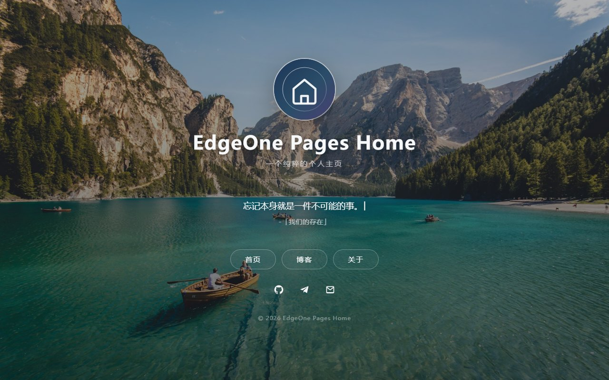

# EdgeOne Pages Home

> 使用 EdgeOne Pages 搭建的纯静态个人主页模板。

一个开箱即用的个人主页模板：全屏 Bing 壁纸、一言打字机、头像全屏/弹跳、响应式布局。前端零框架、零构建，Bing 壁纸和一言由 EdgeOne Pages 的 Cloud Functions 与 Blob 提供支持。

[](https://edgeone.ai/pages/new?repository-url=https%3A%2F%2Fgithub.com%2Fwgh208%2FEdgeOne-Pages-Home&project-name=EdgeOne-Pages-Home)

- 演示地址：<https://wgh.me>
- 开源协议：[MIT](LICENSE)
- 项目仓库：<https://github.com/wgh208/EdgeOne-Pages-Home>



## 特性

- **每日 Bing 壁纸**：定时抓取 Bing 最近 8 天壁纸，自动清理旧图，按日期从新到旧轮换展示。
- **一言打字机**：优先请求一言接口，逐字输入、停留、逐字删除，再随机下一条；接口失败时使用本地兜底句。
- **头像交互**：点击头像进入/退出全屏；鼠标悬停播放果冻弹跳动画。
- **纯静态前端**：无 React/Vue，无构建步骤；CSS、JS、图标全部本地化，无外部字体和 CSS 请求。
- **响应式**：桌面、平板、手机自适应。
- **可直接部署**：点击上方按钮，或在 EdgeOne Pages 控制台导入本仓库。

## 技术栈

| 层 | 技术 |
|---|---|
| 前端 | 原生 HTML / CSS / JavaScript |
| 托管 | [EdgeOne Pages](https://pages.edgeone.ai/) |
| 服务端 | EdgeOne Pages Cloud Functions（Node.js） |
| 存储 | EdgeOne Pages Blob |
| 定时任务 | `edgeone.json` schedules |
| 壁纸来源 | Bing `HPImageArchive` |
| 一言来源 | [Hitokoto](https://hitokoto.cn/) 或自建接口 |

## 架构

```text
浏览器
 ├─ GET /                          index.html
 ├─ GET /assets/*                  本地 CSS / JS / 头像
 ├─ GET /api/bing-image           302 → /api/bing-image?d=YYYY-MM-DD
 ├─ GET /api/bing-image?d=...     返回指定日期壁纸（ETag + 长缓存）
 └─ GET https://v1.hitokoto.cn    一言 JSON（可在 main.js 中替换）

EdgeOne Pages
 ├─ Cloud Function /api/bing-image
 ├─ Cloud Function /api/bing-meta         诊断用
 └─ Cloud Function /api/cron/bing         定时抓取

edgeone.json（每天 16:40 Asia/Shanghai）
 └─ POST /api/cron/bing
      ├─ 请求 Bing 最近 8 天
      ├─ 下载缺失图片到 Blob
      ├─ 写入 bing/list.json
      └─ 清理第 9 天及更早的图片
```

## 目录结构

```text
EdgeOne-Pages-Home/
├─ index.html                      首页
├─ 404.html                        404 页面
├─ favicon.svg                     站点图标
├─ assets/
│  ├─ css/style.css                全站样式
│  ├─ js/main.js                   一言、头像、全屏等交互
│  └─ images/avatar.svg            默认头像（可替换）
├─ cloud-functions/
│  └─ api/
│     ├─ _bing.js                  Bing 抓取、Blob 读写、清理
│     ├─ bing-image.js             按日期顺序轮播的壁纸接口
│     ├─ bing-meta.js              最近 8 天列表（诊断）
│     └─ cron/bing.js              定时任务入口
├─ edgeone.json                    定时任务配置
├─ package.json                    Cloud Functions 依赖
├─ docs/preview.jpg                 README 预览图
├─ LICENSE
└─ README.md
```

## 一键部署

点击下面的按钮，EdgeOne Makers 会自动读取本仓库并创建项目：

[](https://edgeone.ai/pages/new?repository-url=https%3A%2F%2Fgithub.com%2Fwgh208%2FEdgeOne-Pages-Home&project-name=EdgeOne-Pages-Home)

如果所在区域使用腾讯云中国站，也可以：

1. 打开 [EdgeOne Pages 控制台](https://console.cloud.tencent.com/edgeone/pages)；
2. 创建项目 → 导入 Git 仓库；
3. 选择本仓库，构建命令留空，输出目录为根目录 `/`；
4. 点击部署。

部署完成后：

- 首页：`https://<你的项目>.edgeone.app/`
- 首次访问 `/api/bing-image` 会自动补齐 8 天壁纸，可能需要几秒；
- 在控制台为项目绑定自定义域名。

## 配置

### 1. 站点信息

编辑 `index.html`：

- `<title>`、`description`、`keywords`、`author`；
- `.site-title`：站点名称；
- `.site-subtitle`：副标题；
- 头像：替换 `assets/images/avatar.svg`，或修改 `img src`；
- 导航链接：`.nav__link` 的三个 `href`；
- 社交链接：`.social` 中的 GitHub / Telegram / Email；
- 页脚版权。

### 2. 一言

编辑 `assets/js/main.js` 顶部的 `CONFIG`：

```js
const CONFIG = {
    hitokotoUrl: "https://v1.hitokoto.cn/?c=a&c=b&c=c&c=d&c=e&c=f&c=g&max_length=32&_=",
    typingSpeed: 80,
    deletingSpeed: 40,
    stayTime: 12000,
    requestTimeout: 8000,
    fallbackQuotes: [...]
};
```

> 演示站 <https://wgh.me> 使用自建接口；模板为了可移植性默认官方接口，部署后可在 `CONFIG.hitokotoUrl` 中替换为自己的接口。

- `hitokotoUrl`：可替换为自建接口，返回 JSON 中包含 `hitokoto` 和 `from` 即可；
- `typingSpeed` / `deletingSpeed`：输入、删除速度（毫秒/字）；
- `stayTime`：每条停留时间；
- `fallbackQuotes`：接口失败时的本地兜底句。

### 3. Bing 壁纸

编辑 `cloud-functions/api/_bing.js`：

```js
const STORE_NAME = "edgeone-pages-home-bing";
const KEEP_DAYS = 8;
const BING_API = "https://cn.bing.com/HPImageArchive.aspx?format=js&idx=0&n=8&mkt=zh-CN";
```

- `STORE_NAME` 可改为自己的 Blob 名称；
- `KEEP_DAYS` 控制保留天数（至少 7 天）；
- 首次部署后建议手动执行一次：

```bash
curl -X POST https://<你的域名>/api/cron/bing
```

### 4. 定时任务

`edgeone.json` 默认每天 **16:40（Asia/Shanghai）** 抓取一次：

```json
{
  "schedules": [
    {
      "name": "bing-daily",
      "cron": "40 16 * * *",
      "timezone": "Asia/Shanghai",
      "path": "/api/cron/bing",
      "method": "POST"
    }
  ]
}
```

可以按需修改时间。Bing 通常在中国时间下午更新次日壁纸，16:40 可以避开更新空窗。

## Bing 壁纸工作方式

1. 定时任务请求 Bing `HPImageArchive`，取最近 8 天；
2. 把图片下载到 Blob：`bing/YYYY-MM-DD.jpg`；
3. 写入 `bing/list.json`，按日期从新到旧排序；
4. 清理第 9 天及更早的旧图；
5. `/api/bing-image` 用 cookie 记录上次展示日期，下次返回下一天，形成：

```text
最新 → 次新 → ... → 最旧 → 最新
```

6. 带 `?d=YYYY-MM-DD` 的图片地址带 `ETag` 和 1 年不可变缓存，重复轮到时直接命中缓存。

如果 Blob 为空，第一次访问 `/api/bing-image` 会自动抓取，因此首次打开可能需要几秒。

## 一言工作方式

- 页面加载后直接请求接口；
- 请求返回前显示“加载中...”；
- 收到后逐字输入（默认 80ms/字）；
- 显示来源，停留 12 秒；
- 逐字删除（40ms/字）；
- 预取下一句，循环展示；
- 接口超时/失败时随机使用本地兜底句，页面不会空白。

## 本地预览

纯前端部分可以直接用任意静态服务器：

```bash
python3 -m http.server 8080
# 或
npx serve .
```

打开 <http://localhost:8080>。

说明：本地静态服务器没有 `/api/bing-image`，背景会显示 CSS 渐变兜底；一言请求仍然可用。要完整调试 Cloud Functions 和 Blob，请部署到 EdgeOne Pages。

## 常见问题

**Bing 壁纸不显示？**

- 确认已部署 Cloud Functions，且 `/api/bing-meta` 能返回 `count`；
- 手动 `POST /api/cron/bing` 初始化；
- 检查 `edgeone.json` 的定时任务是否生效。

**一言一直是“加载中”？**

- 检查浏览器 Network 中接口是否返回 200；
- 如果使用自建接口，确认 CORS 允许你的域名；
- 接口超时 8 秒后会使用本地兜底句。

**修改了 CSS/JS 但线上没变化？**

- 浏览器可能缓存了旧文件；给 `index.html` 中的资源加版本号，例如 `style.css?v=2`；
- 或在 EdgeOne 控制台刷新缓存。

**Blob 免费额度够吗？**

8 张 Bing 壁纸约 2.6 MB，远低于免费额度；定时任务会持续清理旧图。

## License

[MIT](LICENSE) © 2026 wgh208

## 致谢

- [EdgeOne Pages](https://pages.edgeone.ai/)：静态托管、Cloud Functions、Blob、定时任务；
- [Hitokoto](https://hitokoto.cn/)：一言 API；
- [Bing](https://www.bing.com/)：每日壁纸；
- 页面布局参考了经典 GitHub Pages 个人主页的展示方式，代码与样式为本项目重新实现。\n- README 预览背景来自 [Unsplash](https://unsplash.com/)，仅作展示；实际部署时背景由 Bing 壁纸驱动。
